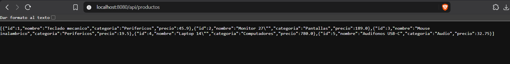
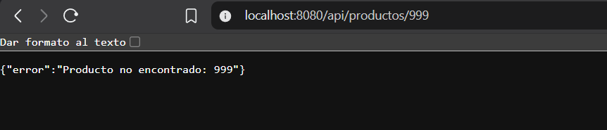
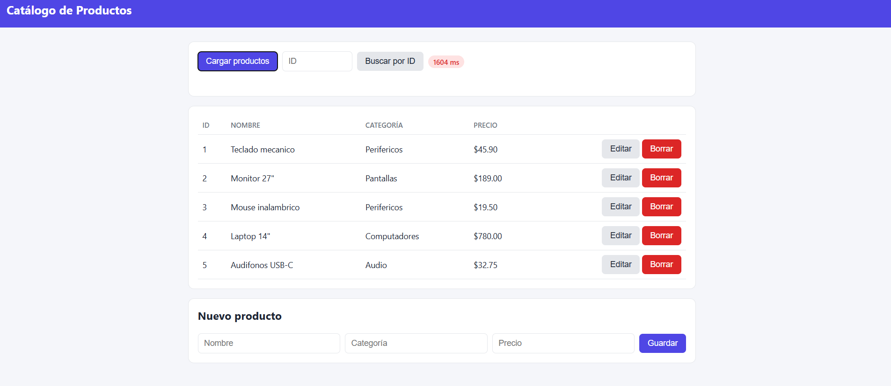
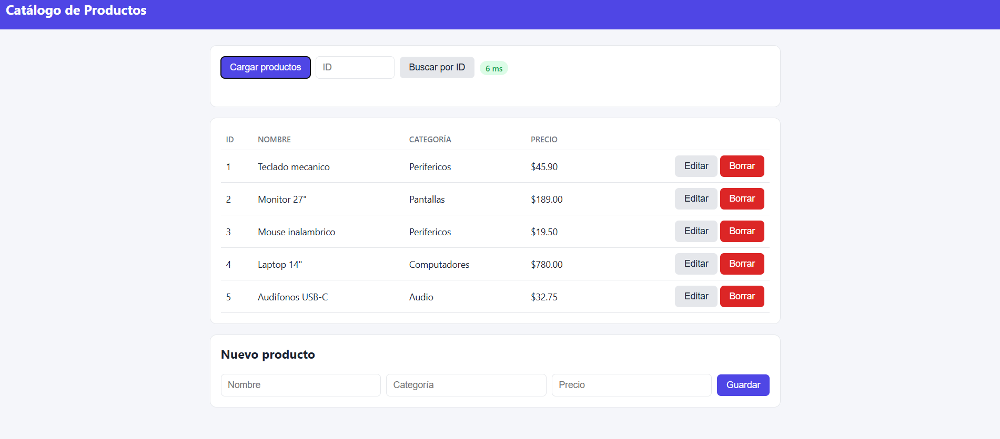
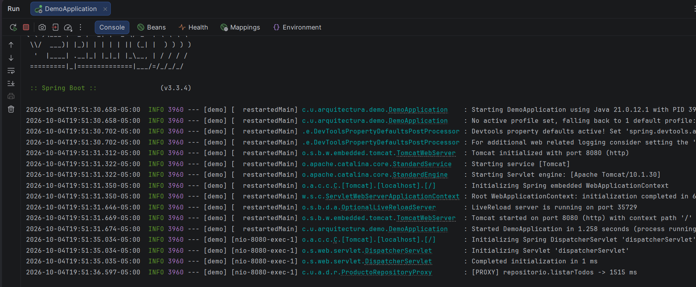
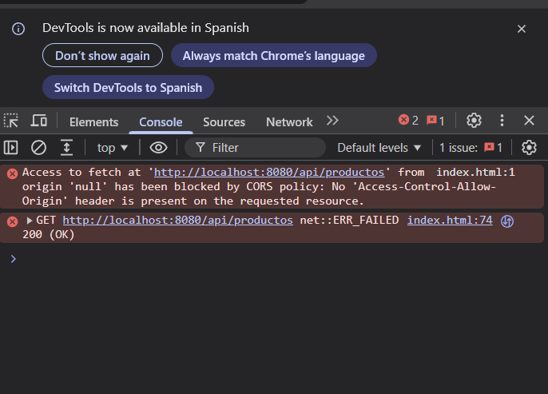

# ISWZ2202 — App base (Sesión 4-6)

App de catálogo de productos (Spring Boot). Cada llamada a la API tiene una
latencia simulada a propósito.

## Requisitos

- Java 17+ únicamente. No necesitas Maven instalado: el proyecto trae el
  Maven Wrapper (`mvnw` / `mvnw.cmd`).

## Ejecutar

```bash
# macOS / Linux
./mvnw spring-boot:run

# Windows
mvnw.cmd spring-boot:run
```

La API queda en `http://localhost:8080`.

```bash
curl http://localhost:8080/api/productos
curl http://localhost:8080/api/productos/1
```

## Actividad (60 min · 10% · Análisis de diseño de software)

**Objetivo:** reforzar el conocimiento adquirido en clase sobre Java y Spring Framework.

1. Completar la aplicación desarrollada en clase.
2. Implementar caché.
3. Implementar el patrón proxy.
4. Pedirle a una IA que genere un frontend para esta API. Van a encontrarse
   con un problema de CORS entre el frontend y este backend — investiguen
   qué lo causa y cómo se resuelve en un ambiente de desarrollo.
5. Suban su proyecto a un repositorio de GitHub propio y entreguen el enlace
   en la consigna.

Se evaluará el diseño de la solución (cohesión, acoplamiento, uso de
abstracciones), no solo que la aplicación funcione.

---

## Solución desarrollada

### Arquitectura
La aplicación conserva una arquitectura en capas: `Controller → Service → ProductoRepository`. Cada capa depende de abstracciones y no de implementaciones concretas, lo que favorece un bajo acoplamiento.

### Funcionalidad completada
Se añadieron las operaciones de creación, actualización y eliminación de productos (`POST`, `PUT`, `DELETE`). Además, se centralizó el manejo de errores en `ManejadorErrores`, que responde con `404` cuando un producto no existe y con `400` ante datos inválidos.






### Caché
Se utilizó la abstracción de caché de Spring (`@EnableCaching` en `CacheConfig`). En `ProductoService`, las consultas se almacenan con `@Cacheable` y las operaciones de escritura invalidan las entradas afectadas con `@CacheEvict`. Como resultado, la primera consulta tarda alrededor de 1,5 s y las siguientes responden en pocos milisegundos.


| Primera consulta (repositorio) | Consulta repetida (caché) |
|---|---|
|  |  |

### Patrón Proxy
`ProductoRepositoryProxy` implementa la misma interfaz que `RepositorioProductoEnMemoria` (sujeto real) y se interpone en cada acceso: valida los datos antes de delegar y registra el tiempo de cada operación. Al anotarse con `@Primary`, Spring lo inyecta en el servicio, que no necesita saber si trabaja con el proxy o con el repositorio real.

La caché y el proxy se mantuvieron separados para que cada componente tenga una única responsabilidad. Esto se puede comprobar en la consola: el registro `[PROXY]` aparece solo cuando la consulta no está en caché.




### Frontend y CORS
El frontend (`frontend/index.html`) consume la API mediante `fetch`. Al ejecutarse en un origen distinto al del backend, el navegador aplica la política de mismo origen y bloquea las respuestas, lo que produce el error:

```
Access to fetch at 'http://localhost:8080/api/productos' from origin 'null'
has been blocked by CORS policy: No 'Access-Control-Allow-Origin' header is present
```

El servidor sí responde correctamente (`200 OK`), pero el navegador descarta la respuesta porque no incluye la cabecera que autoriza al origen del frontend. Para el entorno de desarrollo se resolvió con `CorsConfig`, que declara los orígenes permitidos en `application.properties`. Otras alternativas son la anotación `@CrossOrigin` o un proxy en el servidor de desarrollo del frontend. En producción, la lista de orígenes debe restringirse al dominio real.



Con la configuración aplicada, el frontend consume la API sin restricciones:


### Ejecución
1. Ejecutar `DemoApplication` desde el IDE, o `mvnw.cmd spring-boot:run`.
2. Abrir `frontend/index.html` en el navegador.

### Pruebas
`mvnw.cmd test` ejecuta `ProductoCacheTest`, que verifica el funcionamiento de la caché, su invalidación y el manejo de productos inexistentes.
